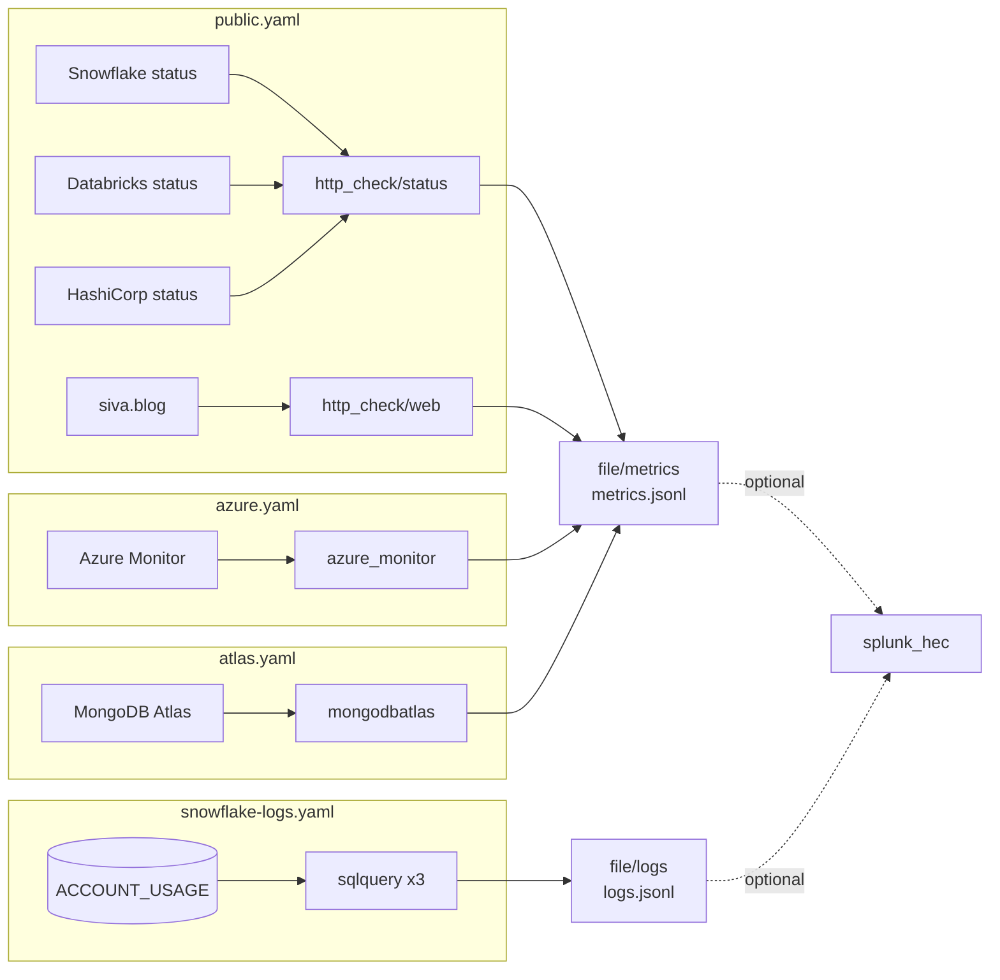

# Argus

Argus watches the platforms a data team depends on — vendor status pages, Azure databases
and web apps, MongoDB Atlas, and Snowflake access logs — using nothing but configuration for
the stock [OpenTelemetry Collector](https://opentelemetry.io/docs/collector/). There is no
application code: every check is a few lines of YAML, and every result is an OTLP JSON line
in a file, ready for a log shipper or Splunk.

This is the second version of Argus. The first was a custom Python engine of the same name;
this one replaces it with configuration. See
[Why configuration instead of code](#why-configuration-instead-of-code).

The name comes from Argus Panoptes, the hundred-eyed giant of Greek myth who was set to
watch and never had all his eyes shut at once.

## Contents

- [Architecture](#architecture)
- [Sources](#sources)
- [Region filters](#region-filters)
- [Output](#output)
- [Run it](#run-it)
- [Test it](#test-it)
- [Enable Splunk](#enable-splunk)
- [Add a check](#add-a-check)
- [Environment variables](#environment-variables)
- [Known limits](#known-limits)
- [Why configuration instead of code](#why-configuration-instead-of-code)
- [Manual steps outside this repository](#manual-steps-outside-this-repository)

## Architecture



- **Image**: `otel/opentelemetry-collector-contrib:0.162.0`, pinned. No custom build and no
  Dockerfile.
- **Layers**: each file in [`config/`](config/) is one concern. The collector merges them in
  the order of its `--config` flags. Maps merge and lists replace, so pipelines are map keys
  (`metrics/public`, `metrics/azure`, `metrics/atlas`, `logs/snowflake`), and the one
  `service.extensions` list lives only in [`config/full.yaml`](config/full.yaml), the last
  layer.
- **Profiles**:

  | Profile | Layers                                                                      | Credentials |
  | ------- | --------------------------------------------------------------------------- | ----------- |
  | public  | `base.yaml public.yaml`                                                     | none        |
  | full    | `base.yaml public.yaml azure.yaml atlas.yaml snowflake-logs.yaml full.yaml` | all sources |

- **Deployment**: Docker Compose ([`compose.yaml`](compose.yaml)) for both profiles;
  Kubernetes ([`kustomization.yaml`](kustomization.yaml), [`deploy/k8s/`](deploy/k8s/)) for the
  full profile.

## Sources

| Layer                 | Receiver        | Scope                                                                                                                                                                 | Interval | Status                                        |
| --------------------- | --------------- | --------------------------------------------------------------------------------------------------------------------------------------------------------------------- | -------- | --------------------------------------------- |
| `public.yaml`         | `http_check`    | Snowflake, Databricks (Azure), HashiCorp status feeds; 12 checks with region filters for Azure East US and East US 2; one web check                                   | 60 s     | **tested** (offline fixtures and live)        |
| `azure.yaml`          | `azure_monitor` | every resource of 5 services in a subscription: App Service (`Microsoft.Web/sites`), PostgreSQL flexible server, Azure SQL database, Cosmos DB, Azure Cache for Redis | 300 s    | configured and validated, **not tested live** |
| `atlas.yaml`          | `mongodbatlas`  | one Atlas project; process, database, and disk metrics                                                                                                                | 3 min    | configured and validated, **not tested live** |
| `snowflake-logs.yaml` | `sqlquery` ×3   | `ACCOUNT_USAGE.LOGIN_HISTORY`, `ACCESS_HISTORY`, `QUERY_HISTORY`, each row once as a log record                                                                       | 300 s    | configured and validated, **not tested live** |

**Azure scope.** The default scope is a subscription (`subscription_ids`), not a resource
group: everything of the listed service types in it is collected. Two commented options in
[`config/azure.yaml`](config/azure.yaml) change that: `discover_subscriptions: true` (every
subscription the identity can read) and `resource_groups` (narrow to named groups).
Authentication uses the `azure_auth` extension with a service principal; managed identity and
workload identity are shown as commented alternatives. The identity needs Monitoring Reader.

**Snowflake rows, once each.** The `sqlquery` receiver stores the tracking column of the last
row and binds it to `?` on the next run; `file_storage` keeps that value across restarts.
`ACCOUNT_USAGE` views fill in late (up to 2 h for login history, 3 h for access history,
45 min for query history), so each query reads only rows older than that latency. A late row
therefore cannot land behind the stored value. `LIMIT 1000` bounds a busy interval.
Prerequisites: a role with `IMPORTED PRIVILEGES` on the `SNOWFLAKE` database, a warehouse, and
Enterprise Edition for `ACCESS_HISTORY`. `QUERY_HISTORY` bodies contain query text, so treat
the output as sensitive.

## Region filters

None of the three vendor APIs takes a region parameter, so the filtering happens in the
collector. The `http_check` receiver reads each response body and evaluates a
[gjson](https://github.com/tidwall/gjson) path against an expected value:

```yaml
- endpoint: "https://api.status.io/1.0/status/5d49ec10226b9e13cb6a422e#databricks.compute.eastus"
  validations:
    - json_path: 'result.status.#(name=="Compute").containers.#(name=="East US").status'
      equals: "Operational"
```

Four rules make this work:

1. **One target, one validation.** The validation metrics count passes and failures per
   target, so one rule per target keeps each result a clean 0 or 1.
2. **The fragment names the check.** The `http.url` attribute is the configured endpoint,
   fragment included, and the HTTP client never sends the fragment to the server. So
   `#<vendor>.<service>.<region>` is how the output tells regions apart.
3. **Plain dotted paths.** `status.indicator`, not `$.status.indicator` — the `$.` form in the
   receiver README does not resolve.
4. **A missing path fails.** If a vendor changes its feed shape, the check reports `failed`;
   it cannot pass silently.

Each vendor stores regions differently (inspected 2026-10-25):

| Vendor                  | Feed                             | Overall                                     | Region                                                                                  |
| ----------------------- | -------------------------------- | ------------------------------------------- | --------------------------------------------------------------------------------------- |
| Snowflake (Statuspage)  | `status.json`, `components.json` | `status.indicator` = `none`                 | `components.#(name=="Azure - East US 2 (Virginia)").status` = `operational`             |
| Databricks (status.io)  | `/1.0/status/<page>`             | `result.status_overall.status_code` = `100` | `result.status.#(name=="Compute").containers.#(name=="East US").status` = `Operational` |
| HashiCorp (incident.io) | `/proxy/status.hashicorp.com`    | `summary.ongoing_incidents.#` = `0`         | `summary.affected_components.#(component_id=="<id>")#\|#` = `0`                         |

- **Snowflake** regions are component groups; the group status summarizes its children.
- **Databricks** lists each service with one `containers[]` entry per Azure region.
- **HashiCorp** has no status per component. A component is unhealthy only when it appears in
  `affected_components`, so the check counts entries for one component ID and expects `0`.
  Region names repeat under several products, so the ID is the only safe key. The entry shape
  `{"component_id": ...}` is assumed from the incident.io format: the feed had no affected
  components when it was inspected.

The full list of 13 checks is in [`config/public.yaml`](config/public.yaml).

## Output

Contract, version 1. Changing it is a breaking change.

| File (container path)          | Signal  |
| ------------------------------ | ------- |
| `/var/lib/argus/metrics.jsonl` | metrics |
| `/var/lib/argus/logs.jsonl`    | logs    |

- OTLP JSON, one export request per line; rotated at 100 MB, 3 backups.
- Compose mounts `/var/lib/argus` at `./data`. Kubernetes uses an `emptyDir`.
- A public check is identified by the fragment of `http.url`: `<vendor>.<service>.<region>`,
  where `<region>` is an Azure short name or `global`.

| Metric                                  | Meaning                                                                                                                                                                                |
| --------------------------------------- | -------------------------------------------------------------------------------------------------------------------------------------------------------------------------------------- |
| `httpcheck.validation.passed` = 1       | the rule held (healthy)                                                                                                                                                                |
| `httpcheck.validation.failed` = 1       | the rule did not hold, or the path is missing (unhealthy)                                                                                                                              |
| `httpcheck.status`                      | 1 for the observed `http.status_class`. Any response with a body is validated, so an error page normally reports `failed`; with no response at all there is no validation point (down) |
| `httpcheck.duration`, `httpcheck.error` | latency, and request errors with `error.message`                                                                                                                                       |
| Azure Monitor and Atlas metrics         | receiver-defined names and resource attributes                                                                                                                                         |

Snowflake rows are log records whose body is the row as JSON. Attributes carry `USER_NAME`
and, depending on the view, `IS_SUCCESS`, `WAREHOUSE_NAME`, and `EXECUTION_STATUS`.

List each check with every result it reported in the file:

```bash
jq -r '.resourceMetrics[].scopeMetrics[].metrics[]
       | select(.name|startswith("httpcheck.validation"))
       | .name as $n | .sum.dataPoints[] | select(.asInt != "0")
       | "\(.attributes[]|select(.key=="http.url").value.stringValue|split("#")[1])\t\($n|ltrimstr("httpcheck.validation."))"' \
   data/metrics.jsonl | sort -u
```

## Run it

Prerequisites: Docker with Compose v2, and `jq` to read the output.

**Public profile — no credentials.**

```bash
mkdir -p data && chmod 777 data      # Linux only; the image runs as UID 10001
docker compose up -d argus
sleep 70 && tail -n 1 data/metrics.jsonl | jq '.resourceMetrics | length'
docker compose down
```

**Full profile.**

```bash
cp .env.example .env                 # fill in values; never commit .env
docker compose --profile full up -d argus-full
```

Snowflake rows appear only after each view's latency window.

**Kubernetes (full profile).**

```bash
kubectl create secret generic argus-credentials --from-env-file=.env
kubectl apply -k .
```

The ConfigMap is generated from `config/` with a hash suffix, so a config change rolls the
Deployment. The pod runs as non-root with a read-only root filesystem.

## Test it

| Script                                       | Network                        | Proves                                                                                                                                                                                                       |
| -------------------------------------------- | ------------------------------ | ------------------------------------------------------------------------------------------------------------------------------------------------------------------------------------------------------------ |
| [`tests/validate.sh`](tests/validate.sh)     | image pull only                | every profile validates; the commented Splunk block validates; the full profile **starts** with placeholder credentials; Compose and Kubernetes list the same layers as the tests; the kustomization renders |
| [`tests/fixtures.sh`](tests/fixtures.sh)     | none (internal Docker network) | against recorded feeds, every check passes when healthy, and exactly the degraded checks fail — including a healthy region next to a degraded one                                                            |
| [`tests/smoke-live.sh`](tests/smoke-live.sh) | yes                            | every check reaches the real feed and reports exactly one result                                                                                                                                             |

The startup step matters: `validate` passes even when an extension is defined but missing from
`service.extensions`; only startup catches it.

Results on 2026-10-25: all three scripts passed. The live run showed Snowflake at
`indicator: minor`, so `snowflake.overall.global` reported `failed` while both Snowflake Azure
regions passed — the region filters doing their job.

Requirements: Docker, `jq`, and `kubectl` (for the kustomize step). Fixtures and how they were
made: [`tests/fixtures/README.md`](tests/fixtures/README.md).

## Enable Splunk

1. In [`config/base.yaml`](config/base.yaml), remove the leading `#` and the space after it from every line between
   `# BEGIN splunk_hec` and `# END splunk_hec`.
2. In each pipeline, replace the `exporters:` line with its commented
   `# exporters: [..., splunk_hec]` line.
3. Set `SPLUNK_HEC_ENDPOINT`, `SPLUNK_HEC_TOKEN`, and `SPLUNK_HEC_INDEX`.

Records go to Splunk HEC with `source: argus` and `sourcetype: otel`. The file output does not
change.

## Add a check

1. Fetch the feed and find the value: `curl -s <url> | jq '<filter>'`.
2. In [`config/public.yaml`](config/public.yaml), copy a target. Change the path and the
   fragment (`#<vendor>.<service>.<region>`).
3. Add the ID to `VALIDATED_CHECKS` in [`tests/lib.sh`](tests/lib.sh), add the data to the
   fixtures, and run `tests/fixtures.sh`.

## Environment variables

| Variable                                                                                                | Layer          | Notes                               |
| ------------------------------------------------------------------------------------------------------- | -------------- | ----------------------------------- |
| `SNOWFLAKE_STATUS_BASE_URL`, `DATABRICKS_STATUS_BASE_URL`, `HASHICORP_STATUS_BASE_URL`, `WEB_CHECK_URL` | public         | test overrides; unset in production |
| `AZURE_SUBSCRIPTION_ID`, `AZURE_TENANT_ID`, `AZURE_CLIENT_ID`, `AZURE_CLIENT_SECRET`                    | azure          | service principal                   |
| `MONGODB_ATLAS_PUBLIC_KEY`, `MONGODB_ATLAS_PRIVATE_KEY`, `MONGODB_ATLAS_PROJECT`                        | atlas          | read-only API key                   |
| `SNOWFLAKE_ACCOUNT`, `SNOWFLAKE_USER`, `SNOWFLAKE_PASSWORD`, `SNOWFLAKE_WAREHOUSE`, `SNOWFLAKE_ROLE`    | snowflake-logs | URL-encode the password             |
| `SNOWFLAKE_LOGS_START`                                                                                  | snowflake-logs | optional first tracking value       |
| `SPLUNK_HEC_ENDPOINT`, `SPLUNK_HEC_TOKEN`, `SPLUNK_HEC_INDEX`                                           | base           | only when Splunk is enabled         |

[`.env.example`](.env.example) lists them all.

## Known limits

- **One fetch per check.** Five Databricks checks fetch the same feed five times a minute.
  That is the price of telling regions apart without code.
- **HashiCorp shape assumed.** The `affected_components` entry shape is not yet confirmed by a
  real incident.
- **Snowflake latency.** Login rows arrive about 2 h late, access rows 3 h, query rows 1 h.
  If more than 1000 rows share the exact boundary timestamp, the rows after the limit are
  skipped.
- **Kubernetes state.** The `emptyDir` loses the output and the Snowflake tracking value when
  the pod moves. Use a PersistentVolumeClaim to keep them.
- **Untested sources.** Azure Monitor, Atlas, and Snowflake are checked against the receivers'
  source and documentation at v0.162.0 and validated with placeholders, but have not run
  against real accounts.

## Why configuration instead of code

The Python engine scheduled checks, retried requests, parsed responses, and wrote JSON lines.
The collector already does each of those, and its receivers for Azure Monitor, Atlas, and SQL
are maintained by people who run them at scale. Keeping a private copy meant owning scheduling
bugs, connector drift, and an export format that only one program wrote. With configuration, a
new check is a YAML diff, the output is OTLP that any backend reads, and the test is whether
the collector accepts the config and gives the right answer on recorded data.

## Manual steps outside this repository

1. Rename the GitHub repository `sivadotblog/k8s-experiments` to `sivadotblog/argus`
   (Settings, General, Repository name). GitHub redirects the old URL.
2. Point the local clone at the new name:
   `git remote set-url origin https://github.com/sivadotblog/argus.git`
3. For Kubernetes, create the `argus-credentials` Secret (see [Run it](#run-it)).
